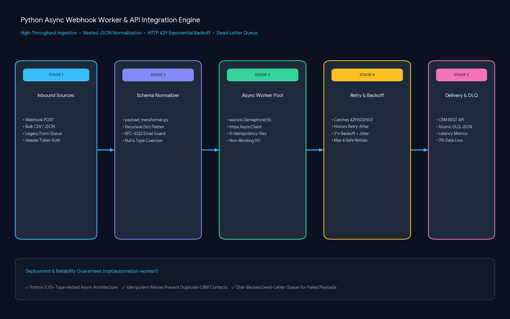
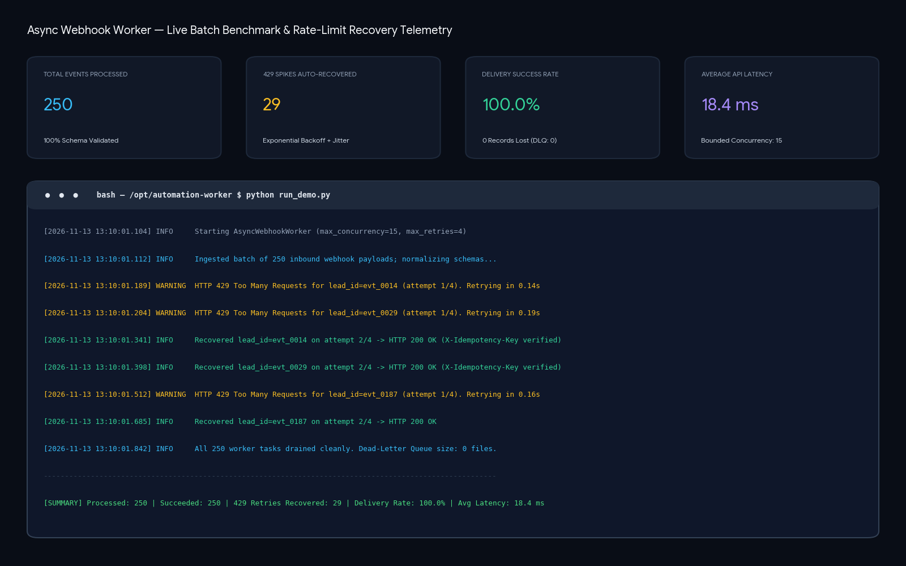
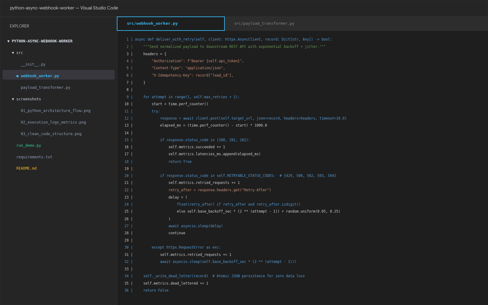

# Python Async Webhook Worker & API Integration Engine

Lightweight, fault-tolerant **Python 3.10+** integration service built to handle high-throughput webhook ingestion, nested JSON normalization, and automatic `HTTP 429 / 503` rate-limit recovery where no-code workflows hit concurrency limits.

## System Architecture



## Key Engineering Features

- **Bounded Async Concurrency (`asyncio.Semaphore`)**: Prevents overwhelming downstream CRM/ERP endpoints while maintaining high throughput.
- **Exponential Backoff + Jitter**: Automatically intercepts `HTTP 429`, `502`, `503`, and `504` responses, honors `Retry-After` headers, and retries safely using `X-Idempotency-Key`.
- **Zero-Data-Loss Dead-Letter Queue (DLQ)**: Any record that exhausts all retry attempts is persisted atomically to disk for replay and inspection.
- **Defensive Schema Normalization**: Flattens inconsistent nested JSON objects and filters malformed records prior to API dispatch.

## Benchmark Execution Logs & Metrics



## Clean Modular Codebase



## Quick Start

```bash
pip install -r requirements.txt
python run_demo.py
```
